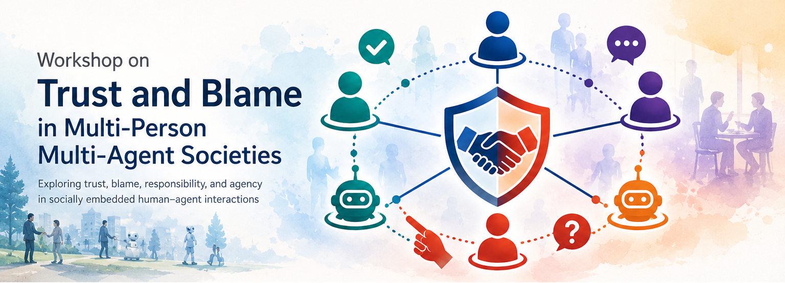
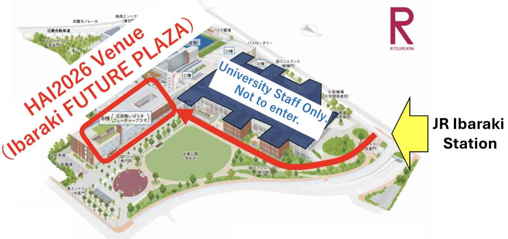
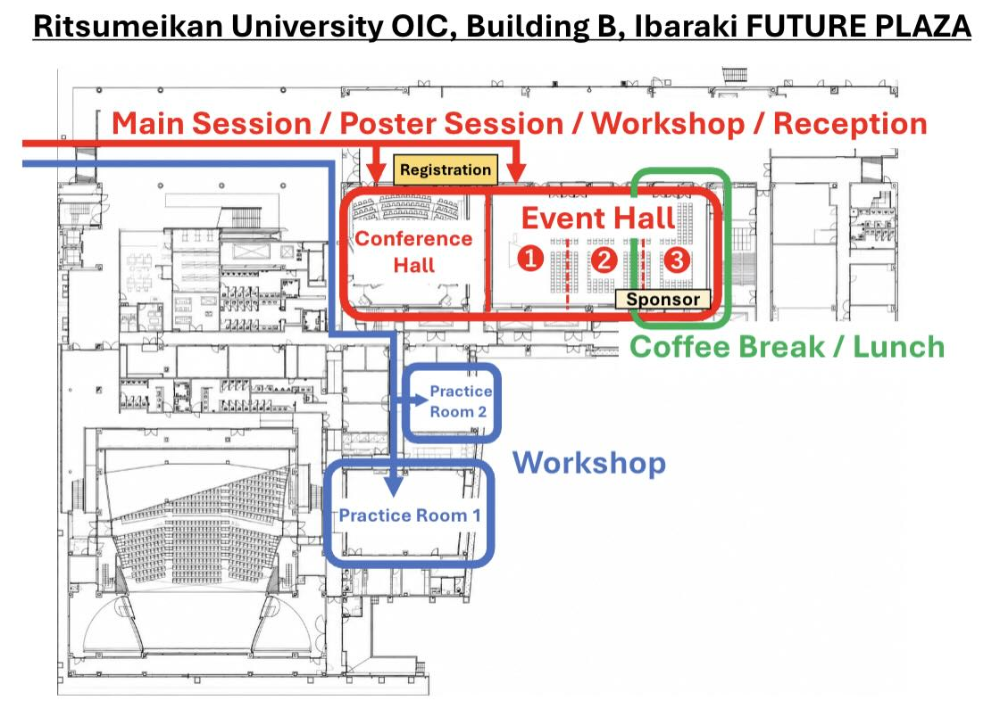

# TBSA 2026_2nd Program  
### on 16th Nov. 2026 as HAI2026 Workshop

## Venue
Practice Room 2 in the ground floor at G building in [OIC](https://en.ritsumei.ac.jp/access/) (Osaka Ibaraki Campus), Ritsumeikan University 

## Join HAI2026 slack 
Join HAI2026 slack (emailed on 11th Nov.) and our workshop channel **#ws-trust_and_blame** in the slack.

## Breaks and Lunch
Coffee breaks and boxed lunches will be provided throughout the conference. We will do our best to ensure that there is enough for everyone, but we kindly ask for your understanding should supplies run out.

## TBA, Tentative Full-Day Timetable

This is planned as a full-day, primarily in-person workshop. 
Limited hybrid participation may be supported depending on the conference infrastructure.

- Normal Talk: 20 mins including Q & A.
- Featured Talk: 30 mins including Q & A.

| Time | Session | Description |
|---|---|---|
| 09:00–09:15 | Pre-Show Mingle ☆ | |
|✧✧✧| ✧✧✧ Session 1-1 ✧✧✧  |Chair: Dr. Ryo Uehara|
| 09:15–09:20 | Opening and Theme Introduction ☆ | Overview of the workshop motivation, scope, and key questions. | |
| 09:20–09:50 | Featured Talk by Soma Araoka | Protecting the Posthumous Self — AI Reconstruction of the Deceased, Unbefangenheit, and Conduct-Based Post-Mortem Personality Protection [PDF](https://lab.yoneyone.net/tmp/tbsa2026pdf/TBSA2026_2nd_paper__8.pdf)  |
| 09:50–10:10 | Talk 1 by Yu Nishitsutsumi | Autonomous Acceptance in Human-Agent Interaction: Rethinking Autonomy through Delegation to Agents [PDF](https://lab.yoneyone.net/tmp/tbsa2026pdf/TBSA2026_2nd_paper__10.pdf)  |
| 10:10–10:30 | Talk 2 by Ryo Uehara | Completing the Duchampian Project: The End of "Authenticity of Origin" and Distributed Trust in AI Art [PDF](https://lab.yoneyone.net/tmp/tbsa2026pdf/TBSA2026_2nd_paper__2.pdf) |
| 10:30–11:00 | ✦✦✦ Break ✦✦✦ |  |
|✧✧✧| ✧✧✧ Session 1-2 ✧✧✧  | Chair: Dr. Ryo Uehara|
| 11:00–11:20 | Talk 3 by Rie Iizuka | “Tell Me It Will Be Okay”: Conversational AI and Low-Burden Emotional Support for Adolescents and Young Adults with Cancer [PDF](https://lab.yoneyone.net/tmp/tbsa2026pdf/TBSA2026_2nd_paper__11.pdf) |
| 11:20–11:40 | Talk 4 by Akiko Orita | Whose Trust, Whose Blame? Distributed Responsibility in AI Recreation of the Deceased: Evidence from Open-Ended Survey Responses [PDF](https://lab.yoneyone.net/tmp/tbsa2026pdf/TBSA2026_2nd_paper__4.pdf) |
| 11:40–12:00 | Talk 5 by Tomoko Yonezawa | From Acceptance and Avoidance to Affective Viscosity: Designing Social Agents Intermediating in Human Relationships [PDF](https://lab.yoneyone.net/tmp/tbsa2026pdf/TBSA2026_2nd_paper__1.pdf) [arXiv](https://arxiv.org/abs/2610.29674)|
| 12:00–13:00 | ✦✦✦ Lunch Break ✦✦✦ |  |  |
| 13:00–13:20 | Thematic Discussion ☆ | Discussion structured around trust/blame/responsibility, multi-person/multi-agent social dynamics, and agency/autonomy/moral-legal status. |
| (casual) | Position Presentations ☆ | Presentations of accepted short papers, position papers, empirical studies, design cases, or scenario papers.|
|✧✧✧| ✧✧✧ Session 2 ✧✧✧  | Chair: Dr. Hirotake Yamazoe |
| 13:20–13:40 | Talk 6 by Naoki Matsumura, Kensuke Sugihara and Tomoko Yonezawa | Influence of Agent Number and Behavior on Users' Psychological Responses in VR Evacuation Training [PDF](https://lab.yoneyone.net/tmp/tbsa2026pdf/TBSA2026_2nd_paper__6.pdf) [arXiv](https://arxiv.org/abs/2610.38536) |
| 13:40-14:00 | Talk 7 by Daigo Suhara and Tomoko Yonezawa | A Study on the Effects of Finger Movements on a Humanoid Hugging Robot [PDF](https://lab.yoneyone.net/tmp/tbsa2026pdf/TBSA2026_2nd_paper__5.pdf) [arXiv](https://arxiv.org/abs/2611.02517) |
| 14:00-14:20 | Talk 8 by Takaya Tamamoto and Tomoko Yonezawa | Touching Projected Agents through the DAT Screen: System Design and Questions of Interaction Boundaries [PDF](https://lab.yoneyone.net/tmp/tbsa2026pdf/TBSA2026_2nd_paper__9.pdf) [arXiv](https://arxiv.org/abs/2611.02525) |
| 14:20-14:40 | Talk 9 by Hirotake Yamazoe and Shingo Yamaguchi | Acceptance and Responsibility Attribution Toward Autonomous Ambulances Across Driving Conditions: A Preliminary Survey of Fire Service Personnel [PDF](https://lab.yoneyone.net/tmp/tbsa2026pdf/TBSA2026_2nd_paper__13.pdf) [arXiv](https://arxiv.org/abs/2611.01132) |
| 14:40-15:00 | Talk 10 by Miho Chiyonobu, Yuki Takemoto, Yu Ishikawa and Masami Takata | Distribution Is Not Enough:Trust and Blame in Multi-Person Multi-Agent Environments under Information Ethics 2.0 [PDF](https://lab.yoneyone.net/tmp/tbsa2026pdf/TBSA2026_2nd_paper__7.pdf) |
| 15:00–15:30 | ✦✦✦ Break ✦✦✦ ||
|✧✧✧| ✧✧✧ Session 3 ✧✧✧  | Chair: Dr. Kunifumi Saito |
| 15:30-15:50 | Talk 11 by Jaeyoun You | [**Zoom**] Adversaries, Not Enemies: Delegated Speech and Displaced Blame in AI-Mediated Political Dialogue [PDF](https://lab.yoneyone.net/tmp/tbsa2026pdf/TBSA2026_2nd_paper__12.pdf) |
| 15:50-16:10 | Talk 12 by Kunifumi Saito | Digital Afterlife and the Postmortem Right of Publicity [PDF](https://lab.yoneyone.net/tmp/tbsa2026pdf/TBSA2026_2nd_paper__3.pdf) |
| 16:10-16:30 | Panel Discussion ☆ | Cross-disciplinary discussion connecting HAI, social robotics, AI ethics, philosophy, law, and design perspectives. |
| 16:30–17:00 | Breakout Group Activity / Issue Mapping ☆ | Small-group discussion to identify key issues, research gaps, design questions, and application scenarios. |
| 17:00–17:10 | Final Synthesis and Future Agenda ☆ | Synthesis of discussion outcomes, including a preliminary issue map, future research agenda, and possible follow-up activities. |

## Facilitation Plan

The workshop will use a structured discussion format to connect diverse perspectives from HAI, social robotics, AI ethics, philosophy, law, psychology, and interaction design.

Discussions will be organized around three axes:

1. Trust, blame, and responsibility
2. Multi-person and multi-agent social dynamics
3. Agency, autonomy, psychological safety, and moral/legal status

These axes will help participants distinguish the core themes from related cases and application domains, and synthesize the discussion into a preliminary issue map and research agenda.

<!--

## Summary
- Venue: TBA
- Date and Time: March 10th Morning Half Day (9:00–12:30)
- 1 Invited Talk and 5 Accepted Papers
- The presentation time for accepted papers should be 15 minutes, including time for Q and A.

## Program Schedule

According to [the general program of Persuasive 2026](https://virtualcom-designlab.github.io/TBSA2026/program.html#persuasive-2026-ws-day-program), 
we change the program as follows.

in the case of hybrid: [Zoom Link](https://kansai-u-ac-jp.zoom.us/j/8846013684?pwd=T3JGMmNzcUV4RTlLY1E0Y0VXa1ljQT09)

- [TBSA Photo Page using the password](http://lab.yoneyone.net/tbsa/gdrivelink.html)
(Use tbsa as login user name, and use password as we announced in the workshop.)
- [Persuasive Official Photos](https://photos.google.com/share/AF1QipMccRy060h9CfW_RbYJXS1E7X_eGA3uqlbJ5o1SADC5Ug1n9KIBqtkqF5TJKl2GsQ?pli=1&key=Q0xaMnlmeTFxbXhXaUNMaGQ5cVlqMjhvZTZNenJ3)

| Time    | Presenter    | Title   |
| :-------- | :--------- | :------- |
| 09:00-09:10     | Organizers       | Opening    |
| 09:10-09:40     | [Invited Talk:](invited.md) |  [Technology Acceptance and Autonomy: How Should We Understand Technologies That Transform the Mind?](invited.md)    by Dr. Yu Nishitsutsumi   |
| 09:40-09:55     | Ryo Uehara  | Philosophical Persuasion: How Technology Reshapes Intuitions on Reality and Agency    |
| ~~09:55-10:30~~     | ~~Break Time~~       | ~~(Official Morning Tea)~~    |
| ~~10:30-10:45~~     | ~~Tomoko Yonezawa~~    | ~~Negative Aversion and Real Reliability for Building Familiar Human-Agent Relationships~~    |
| ~~10:45-11:00~~     | ~~Kentaro Meiseki~~     | ~~Trust and Behavioral Change in Comments by Confirmation Message Agent **Online**~~   |
| 09:55-10:10     | Tomoko Yonezawa    | Negative Aversion and Real Reliability for Building Familiar Human-Agent Relationships    |
| 10:10-10:25     | Kentaro Meiseki     | Trust and Behavioral Change in Comments by Confirmation Message Agent **Online**   |
| 10:30-11:00     | Break Time       | (Official Morning Tea)    |
| 11:00-11:15     | Discussion and Mingling       | --    |
| 11:15-11:30     | Hirotake Yamazoe       | Trust and Responsibility Attribution Toward Automated Ambulances: A Preliminary Survey of Japanese Fire Service Personnel    |
| 11:30-11:45     | Kunifumi Saito       | Governing the Dynamic Dead: Civility and Persuasion in Posthumous Digital Personas    |
| 11:45-12:15     | Discussions  | (Trust and Blame in Social Agents and Technology, Ethics and Guidelines in Future)    |
| 12:15-12:20     | Organizers | Closing    |
| 12:30-13:30     | -- | Official Lunch    |

### HAI 2026 common WS day program

| Time    | Schedule    |
| :-------- | :--------- | 
|08:00 – 9:00		|__Registration__ |
|09:00 – 10:30		|Workshops, Tutorials|
|10:30 – 11:00		|**Morning Tea** |
|11:00 – 12:30		|Workshops, Tutorials|
|12:30 – 13:30		|**Lunch**|
|13:30 – 15:00		|Workshops, Doctoral Consortium |
|15:00 – 15:30 		|**Afternoon Tea** |
|15:30 – 17:00		|Workshops, Doctoral Consortium |
|17:00 – 18:00		|Steering Committee Meeting / PT2026 Organization Meeting|

---
[back to top page](index.html)
____

----

## All Workshops, Tutorials, and Doctoral Consortium in Persuasive 2026

### Morning Half Day (9:00–12:30)

- Room 593
The 1st International Workshop on Trust and Blame in Social Agents (TBSA 2026)
(6 presenters)

- Room 594
Tutorial: Self-Regulated Learning Tool for Academic Success

### Afternoon Half Day (13:30–15:00)

- Room 593
Joint Workshop:
Personalizing Persuasive Technologies Workshop 2026 (PPT 2026) +
The 2nd International Workshop on Upholding Ethical Designs (I-WOULD 2026)
(3 presenters)

- Room 594
Doctoral Consortium
(2 presenters)

### Full Day (9:00–17:00)

- Electrical Engineering Room
The 3rd BTI International Workshop (BTIW3)
(12 presenters)

- Auditorium
BCSS Full-Day Workshop
(approximately 10 presenters)

-->

---
[back to top page](index.html)

